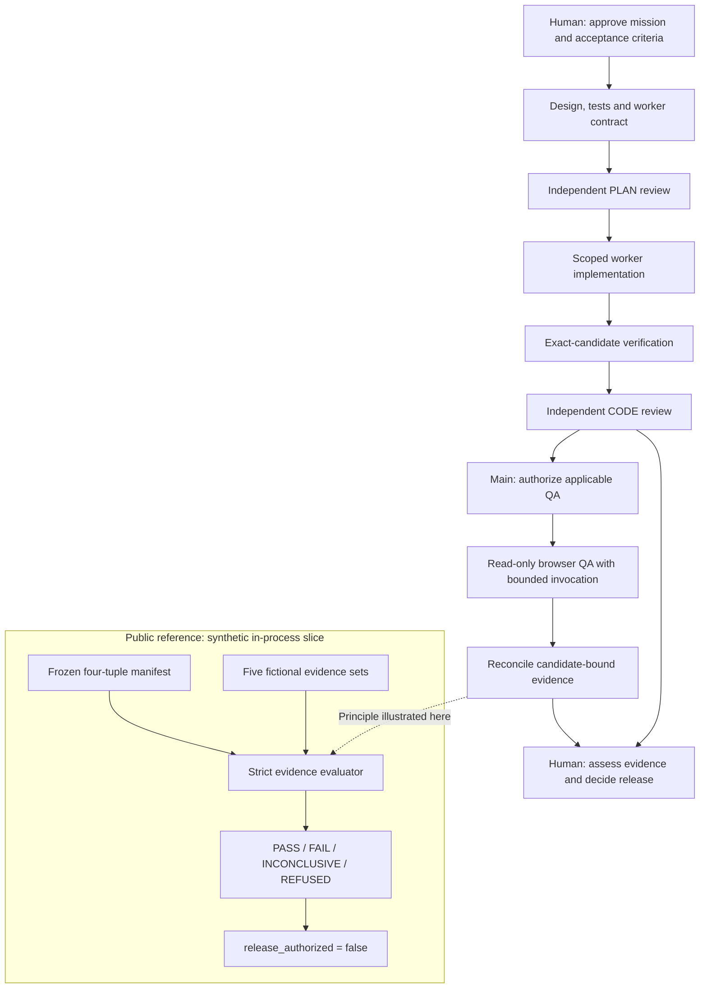

# Architecture: connect work to evidence

Factory V2 treats agent work as a sequence of inspectable handoffs. An approved mission supplies the acceptance criteria; design and tests turn that intent into a bounded implementation contract. Independent review and verification then assess different parts of the result.

The diagram describes the broader V2 design. The separate public-reference subgraph is the only part implemented in this repository. It illustrates one evidence principle without running the surrounding workflow.

## Roles and authority

The architecture separates the party implementing a change from independent PLAN and CODE reviewers. Main controls dispatch and applicable QA authorization. Humans retain mission and release authority. A passing local check, an independent review, and a QA result are separate kinds of evidence; none by itself authorizes external deployment.

Main-only dispatch, read-only QA scope, bounded initial/retest invocation, and avoiding second-model inference are documented V2 design choices. The reference does not implement those orchestration controls. It starts no agent and exercises no harness or browser.

## The executable slice

`demo.py` contains three small layers:

1. `MANIFEST` enumerates four immutable `Requirement` records and fixed fictional identity labels.
2. `make_evidence()` and `run_demo()` create fresh in-memory fixtures for the five scenarios.
3. `evaluate(evidence)` validates each supplied record, reconciles coverage, and returns a verdict with reasons and unmet checks.

The evaluator scans all records before deciding, so a late malformed record cannot be hidden behind an earlier satisfied or violated assertion. It never edits evidence, repairs labels, fills missing observations, or rewrites the manifest. Results are new data structures, ordered by the frozen manifest where coverage is reported.

## Two different notions of success

A scenario’s `result.verdict` describes the supplied synthetic QA evidence. A top-level `checks[].passed` describes whether the demo exhibited its expected behavior. The seeded-defect scenario must remain `FAIL` for the demonstration’s corresponding check to pass. The CLI exit code reports reference-check success, never release eligibility.

This distinction makes negative examples useful without laundering their outcomes into a generic success label.
